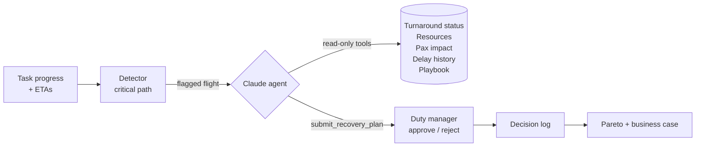
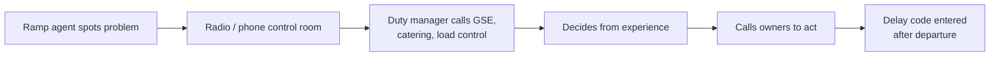
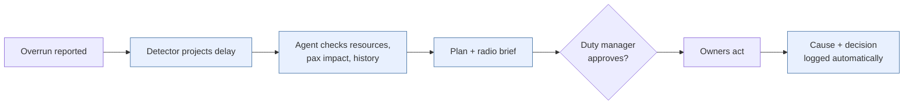

# ✈️ Turnaround Delay Assistant

**Live demo:** [tobinjohnson.github.io/turnaround-delay-assistant](https://tobinjohnson.github.io/turnaround-delay-assistant/) (runs in your browser, ~15 s to load) · [Streamlit Cloud mirror](https://turnaround-delay-assistant.streamlit.app) (may need a wake-up click)

**An AI agent that flags aircraft turnarounds about to miss their departure time and drafts recovery actions for a human duty manager to approve.**

Built from delay patterns I saw first-hand in 7 years of airline ground operations (2015–2022). This project rebuilds those problems with today's AI tools.

> All data is synthetic: fictional airline "XA", fictional tails, one simulated station. The *structure* (turnaround tasks, IATA delay codes, GSE and staff resources) mirrors a real ground-handling control room.

---

## The problem

An A320 domestic turnaround has **45 minutes** of ground time. Deboarding, offload, cleaning, catering, fuelling, loading, boarding and the load sheet all run in parallel, and some wait on each other. One broken belt loader or a late catering truck pushes the whole chain, and the flight misses its STD.

**How recovery works today:** a ramp agent radios the control room. The duty manager phones GSE, catering and load control, decides from experience, and the delay code is entered *after* departure. Recovery depends on who is on shift, and the root-cause data arrives too late to learn from.

## What this project does

| Step | Component | Process-excellence angle |
|---|---|---|
| 1. Detect | `detector.py` projects each turn's ready time along the critical path and flags any flight ≥5 min late (RAG status) | Critical-path analysis |
| 2. Investigate | `agent.py`: a Claude agent calls read-only tools for turnaround status, resource availability, passenger and network impact, 60-day delay history, and the station playbook | AI-assisted decision support |
| 3. Recommend | The agent submits a structured plan with actions, owners, minutes saved, risks and a radio-style brief | Standard work |
| 4. Human decides | The duty manager approves or rejects the plan in the dashboard. Every decision is logged | Human-in-the-loop, audit trail |
| 5. Learn | A Pareto of delay minutes by IATA code shows which root causes to fix first | 80/20 root-cause analysis |
| 6. Justify | A business-case calculator with sensitivity analysis | Value quantification |

The **rule-based playbook** (`rule_based_plan`) is the "before AI" baseline. It runs when no API key is set, so the demo always works.

## Architecture



**Safety design**
- The agent has **only read-only tools**. It cannot change anything in the operation; its only output is a plan.
- The system prompt forbids skipping safety checks, baggage reconciliation or SOP conditions.
- Every tool call is kept in a reasoning trail that the duty manager can open.
- If the AI call fails, the dashboard falls back to the playbook.

## Process maps

**As-is (manual)**


**To-be (AI-assisted, human-in-the-loop)**


## Run it

```bash
python3 -m venv .venv && source .venv/bin/activate
pip install -r requirements.txt
python data_generator.py          # creates data/*.csv
streamlit run app.py              # opens the dashboard
```

To enable the AI agent, set an Anthropic API key (each plan costs a few cents):

```bash
export ANTHROPIC_API_KEY=sk-ant-...
```

Command-line use:

```bash
python agent.py XA123             # Claude agent (or the playbook if no key is set)
python agent.py XA123 --rules     # force the rule-based playbook
pytest -q                         # tests (no API key needed)
```

## Use your own data: the sample airline

In the dashboard sidebar, pick **Data → Sample airline**. It loads a small fictional airline (XK, Demo Regional Air) with 12 flights at one station (TRV), built from two files you can edit in Excel or any text editor:

- `sample_data/schedule.csv`: one row per flight. Times are `HH:MM`. To simulate a ground problem, set `problem_task` (e.g. `Catering`, `Baggage offload`, `Fuelling`, `Boarding`) and `problem_extra_min`. Leave them empty for a clean turn.
- `sample_data/resources.csv`: equipment and staff on shift (total, in use, unserviceable, available).

Save the file and refresh the page. `build_sample.py` turns the schedule into the task-level data the app reads (`flights.csv`, `tasks.csv`). The snapshot time is 14:00, so flights around then show live delays.

## Project structure

```
turnaround.py       domain knowledge: 45-min plan, task dependencies, IATA codes, playbook
data_generator.py   synthetic day of 48 turnarounds + resources + 60-day delay history
build_sample.py     builds the sample airline's data from sample_data/schedule.csv
sample_data/        sample airline: editable schedule.csv and resources.csv
detector.py         critical-path delay projection and RAG flagging
tools.py            read-only agent tools + their JSON schemas
agent.py            Claude agent loop + rule-based baseline
app.py              Streamlit control-room dashboard
tests/              pipeline tests, including the agent loop with a fake client
docs/               interview guide, resume bullets
```

## Business case (default assumptions, all editable in the app)

120 departures/day × 15% flagged × 70% of plans executed × 6 min saved × 1.3 reactionary multiplier × $100 per delay minute ≈ **$3.6M a year** for one station.

The $100/min figure is a rounded assumption based on airline delay-cost studies. Replace it with your own airline's figure. The sensitivity table in the app runs from 3 to 10 minutes saved and from $60 to $140 per minute.

## Limitations and next steps

- Synthetic data. A real version would connect to the AODB (flight times), the DCS (passengers and bags), GSE telematics and SAP PM/MM (equipment status and spares).
- The detector uses fixed task durations. Next step: learn durations per aircraft type, stand and hour from history.
- Compare plans: log the AI plan, the playbook plan and the duty manager's actual action, then measure which one recovers more minutes.
- Add a process-mining view (PM4Py) of real turnaround event logs to find the most common delay variants.
